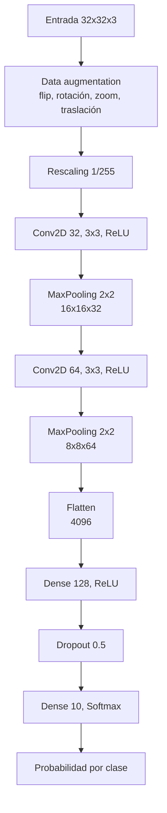
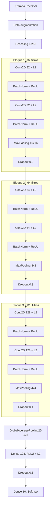
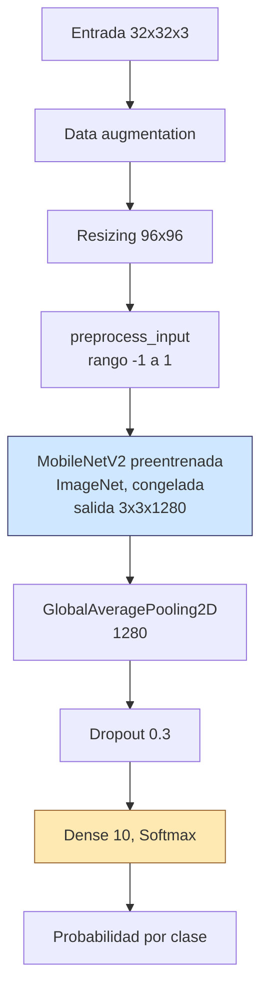

# Diagramas de las arquitecturas CNN (CIFAR-10)

Diagramas de flujo de las tres arquitecturas probadas en [Arquitecturas_cnn.ipynb](Arquitecturas_cnn.ipynb).

## Dataset y salida del modelo

**Imágenes:** CIFAR-10 tiene 60,000 imágenes a color (RGB) de 32x32 píxeles, 50,000 para entrenamiento y 10,000 para prueba. Son fotos pequeñas de objetos y animales comunes, de baja resolución.

**Qué predecimos:** a qué clase pertenece cada imagen. Hay 10 clases: avión, automóvil, pájaro, gato, ciervo, perro, rana, caballo, barco y camión.

**Salida del modelo:** un vector de 10 probabilidades, una por clase, que suman 1 (capa `Dense(10, softmax)`). La clase con mayor probabilidad es la predicción. Por ejemplo, si la salida más alta es la posición 3, el modelo dice "gato".

Es un problema de clasificación multiclase. Las etiquetas son números del 0 al 9, por eso se usó `sparse_categorical_crossentropy`.

## 1. CNN simple (`cnn_simple`)

## 2. CNN profunda (`cnn_profunda`)

## 3. MobileNetV2 con transfer learning (`mobilenetv2_transfer`)

Azul: pesos congelados. Naranja: única parte que se entrena.
